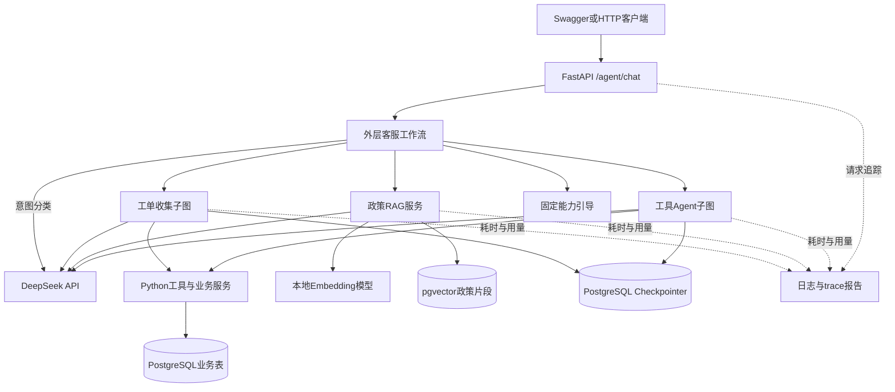
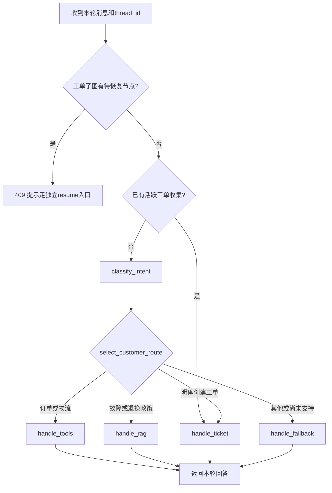
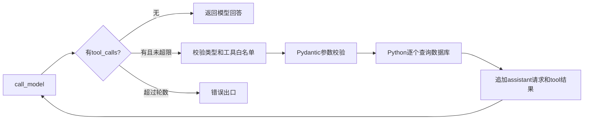
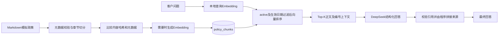
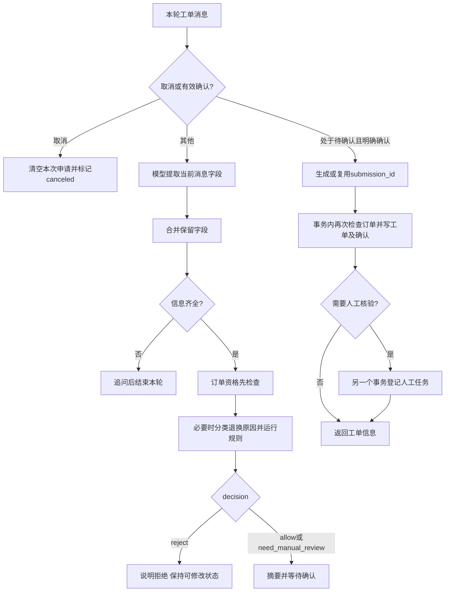
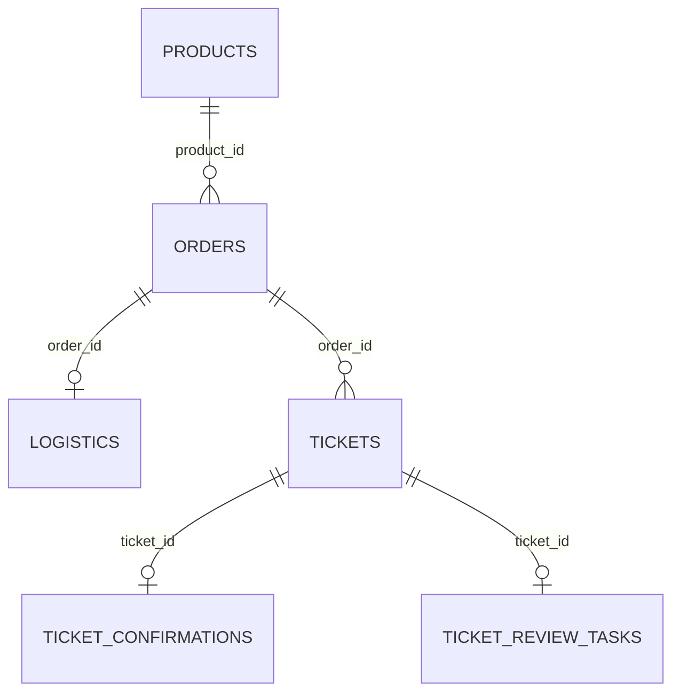

# ServiceFlow 架构与责任边界

本文对应当前代码，不把实验组件画成正式路径。项目使用模拟业务数据，不执行真实退款或审批。

## 1. 系统总览

业务表、政策向量表、checkpoint表目前位于同一个PostgreSQL实例；图中分开表示职责，不表示三个数据库服务。
DeepSeek通过网络调用，本地Embedding负责生成检索向量；没有在本机部署DeepSeek聊天模型。
外层workflow每轮重新创建状态，本身没有配置checkpointer；持久化的是工具子图与工单子图，不要声称所有节点都独立持久化。

## 2. 外层工作流到底选择什么？

入口：`serviceflow/api.py` → `serviceflow/agent/workflow.py`。

`route_customer_entry`和`route_customer_workflow`是条件边使用的路由函数，不是图节点。
活跃工单优先继续收集，避免“换货”这类短回复被重新当作独立政策问题。
一个请求只进入一个外层分支，不会自动依次执行工具、RAG和工单全部分支。联合订单/物流在工具子图内完成。
当前PRODUCT_QUERY会走fallback；有商品REST查询接口不等于已有商品Agent工具。

## 3. 工具循环：模型提出请求，程序执行

入口：`serviceflow/agent/graph.py`、`runtime.py`、`tools.py`。

当前只有get_order和get_logistics两个Agent工具。单轮多个工具请求由for循环依次执行，不是数据库并行查询。
第一轮模型可以只选择工具，Python才是真正执行数据库查询的一方。后续模型根据工具结果生成回答。
函数白名单不是数据授权：当前没有用户登录和订单归属验证，不应对外网公开。

## 4. RAG：离线建索引与在线问答

正式问答当前默认Top-K=3，无额外category/applicable_product限制；检索函数支持这些参数，但不能声称每次正式请求都已按商品类别过滤。
关键词分词与RRF仍是离线对照实验，没有接入正式问答。两种策略的20题Hit@5都是95%，改善012但回退014。
引用合法不等于语义正确：进水案例缺保修限制片段，最终回答仍可能不完整。

## 5. 工单子图：收集不等于提交

入口：`serviceflow/agent/ticket_collection.py`、`ticket_assessment.py`、`serviceflow/ticket/`。

图中的“订单检查→退换规则”是预评估函数内部步骤，不都是独立LangGraph节点。
达到END仅表示本轮处理结束，申请仍可能处于collecting或ready_for_confirmation，下一轮用同一thread_id恢复。
工单open表示已登记，不表示换货/退款获批；没有人工操作界面，也没有自动退款。
当前规则保守，很多情况进入need_manual_review；allow只允许继续登记，不是资金或售后审批。

## 6. 数据模型

| 表或表组 | 职责 |
|---|---|
| products / orders / logistics | 商品、订单与物流事实，供工具及规则读取 |
| tickets | 正式工单；submission_id唯一约束防重复提交 |
| ticket_confirmations | 用户确认原话、时间和申请快照，与工单同事务保存 |
| ticket_review_tasks | 待人工处理记录，以ticket_id防重复登记；不是外部消息队列 |
| policy_chunks | 正文、版本、日期、来源、内容哈希和vector(512) |
| checkpoints / checkpoint_blobs / checkpoint_writes / checkpoint_migrations | LangGraph管理的流程存档与迁移，不替代业务审计表 |

前三张关联及工单关联来自当前ORM外键；checkpoint表由PostgresSaver.setup管理，没有业务表外键。

## 7. 三种ID不要混用

| ID | 生命周期 | 用途 |
|---|---|---|
| thread_id | 多轮会话 | 恢复对话/工单收集 |
| trace_id | 单次HTTP请求 | 关联日志、耗时和模型用量 |
| submission_id | 一次工单提交 | 相同申请失败重试时避免重复写入 |

它们都不等于用户身份，也不能单独作为访问权限凭证。

## 8. 部署与验证边界

Mac:8001 → API容器:8000 → postgres服务:5432。业务数据及模型缓存分别用命名卷保存，.env只在运行时注入。
空库测试使用独立Compose项目和卷，Mac:8002；测试服务验收后已停止，数据卷保留。
SSE只有独立文本生成Demo；请求日志是单服务关联，不是跨服务父子Span追踪。
可复现命令与实际证据见docker-deployment.md，分层评测和语义限制见evaluation/workflow_evaluation.md。
